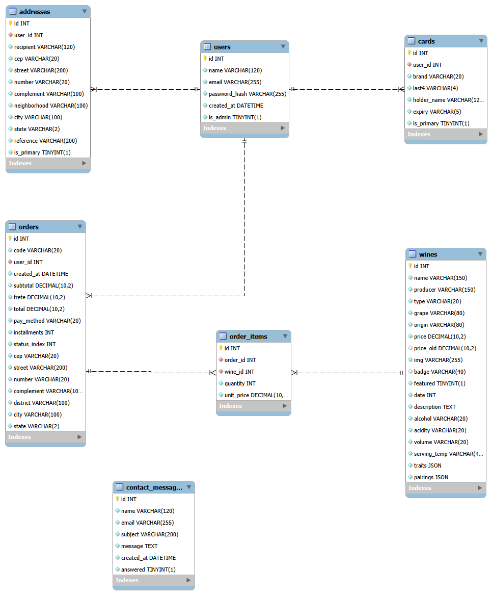

# Banco de dados: Brisa Vinícola

Banco **MySQL** (`brisa_vinicola`) usado pela API em Python (FastAPI + SQLAlchemy).

## DER



O arquivo `brisa_vinicola.mwb` é o modelo editável (MySQL Workbench).

## Relacionamentos

| Relação | Cardinalidade | Observação |
|---|---|---|
| `users` → `orders` | 1:N | Um usuário faz vários pedidos |
| `users` → `addresses` | 1:N | Um usuário tem vários endereços salvos |
| `users` → `cards` | 1:N | Um usuário tem vários cartões salvos |
| `orders` → `order_items` | 1:N | Um pedido tem vários itens |
| `wines` → `order_items` | 1:N | Um vinho aparece em vários itens |
| `orders` ↔ `wines` | N:M | Resolvida pela tabela `order_items` |

## Dicionário de dados

### wines (vinhos)
| Coluna | Tipo | Nulo | Chave | Descrição |
|---|---|---|---|---|
| id | INT | não | PK | Identificador |
| name | VARCHAR(150) | não | | Nome do vinho |
| producer | VARCHAR(150) | não | | Produtor |
| type | VARCHAR(20) | não | | Tinto, Branco, Espumante ou Rosé |
| grape | VARCHAR(80) | não | | Uva |
| origin | VARCHAR(80) | não | | País de origem |
| price | DECIMAL(10,2) | não | | Preço atual |
| price_old | DECIMAL(10,2) | sim | | Preço anterior (promoção) |
| img | VARCHAR(255) | não | | Nome do arquivo da imagem |
| badge | VARCHAR(40) | sim | | Selo (ex.: "20% OFF") |
| featured | TINYINT(1) | não | | Vinho em destaque / mais vendido |
| date | INT | não | | Ordem de lançamento (usada em "Mais recentes") |
| description | TEXT | não | | Descrição |
| alcohol | VARCHAR(20) | não | | Teor alcoólico |
| acidity | VARCHAR(20) | não | | Acidez total |
| volume | VARCHAR(20) | não | | Volume da garrafa |
| serving_temp | VARCHAR(40) | não | | Temperatura de serviço |
| traits | JSON | não | | Lista de características |
| pairings | JSON | não | | Lista de harmonizações |

### users (usuários)
| Coluna | Tipo | Nulo | Chave | Descrição |
|---|---|---|---|---|
| id | INT | não | PK | Identificador |
| name | VARCHAR(120) | não | | Nome |
| email | VARCHAR(255) | não | UNIQUE | E-mail (login) |
| password_hash | VARCHAR(255) | não | | Senha criptografada (bcrypt) |
| created_at | DATETIME | não | | Data do cadastro |
| is_admin | TINYINT(1) | não | | Administrador (0 = cliente, 1 = admin) |

### orders (pedidos)
| Coluna | Tipo | Nulo | Chave | Descrição |
|---|---|---|---|---|
| id | INT | não | PK | Identificador |
| code | VARCHAR(20) | não | UNIQUE | Código do pedido (ex.: BV-000001) |
| user_id | INT | não | FK → users.id | Dono do pedido |
| created_at | DATETIME | não | | Data do pedido |
| subtotal | DECIMAL(10,2) | não | | Soma dos itens |
| frete | DECIMAL(10,2) | não | | Valor do frete (por estado) |
| total | DECIMAL(10,2) | não | | Subtotal + frete |
| pay_method | VARCHAR(20) | não | | pix, cartao-credito ou cartao-debito |
| installments | INT | não | | Parcelas (1 se não for crédito) |
| status_index | INT | não | | Etapa da entrega, de 0 (pagamento aprovado) a 6 (entregue) |
| cep, street, number, complement, district, city, state | VARCHAR | não* | | Endereço de entrega copiado no momento da compra (*complemento pode ser vazio) |

### order_items (itens do pedido)
| Coluna | Tipo | Nulo | Chave | Descrição |
|---|---|---|---|---|
| id | INT | não | PK | Identificador |
| order_id | INT | não | FK → orders.id | Pedido |
| wine_id | INT | não | FK → wines.id | Vinho |
| quantity | INT | não | | Quantidade |
| unit_price | DECIMAL(10,2) | não | | Preço unitário na hora da compra |

### addresses (endereços salvos)
| Coluna | Tipo | Nulo | Chave | Descrição |
|---|---|---|---|---|
| id | INT | não | PK | Identificador |
| user_id | INT | não | FK → users.id | Dono do endereço |
| recipient | VARCHAR(120) | não | | Destinatário |
| cep | VARCHAR(20) | não | | CEP |
| street | VARCHAR(200) | não | | Rua |
| number | VARCHAR(20) | não | | Número |
| complement | VARCHAR(100) | não | | Complemento (pode ser vazio) |
| neighborhood | VARCHAR(100) | não | | Bairro |
| city | VARCHAR(100) | não | | Cidade |
| state | VARCHAR(2) | não | | UF |
| reference | VARCHAR(200) | não | | Ponto de referência (pode ser vazio) |
| is_primary | TINYINT(1) | não | | Endereço principal |

### cards (cartões salvos)
| Coluna | Tipo | Nulo | Chave | Descrição |
|---|---|---|---|---|
| id | INT | não | PK | Identificador |
| user_id | INT | não | FK → users.id | Dono do cartão |
| brand | VARCHAR(20) | não | | Bandeira (Visa, Mastercard...) |
| last4 | VARCHAR(4) | não | | Últimos 4 dígitos |
| holder_name | VARCHAR(120) | não | | Nome do titular |
| expiry | VARCHAR(5) | não | | Validade (MM/AA) |
| is_primary | TINYINT(1) | não | | Cartão principal |

### contact_messages (mensagens do Fale Conosco)
| Coluna | Tipo | Nulo | Chave | Descrição |
|---|---|---|---|---|
| id | INT | não | PK | Identificador |
| name | VARCHAR(120) | não | | Nome de quem escreveu |
| email | VARCHAR(255) | não | | E-mail de contato |
| subject | VARCHAR(200) | não | | Assunto |
| message | TEXT | não | | Mensagem |
| created_at | DATETIME | não | | Data de envio |
| answered | TINYINT(1) | não | | Marcada como respondida |

Esta tabela é independente (sem chave estrangeira), porque visitantes sem conta também podem enviar mensagens.

## Decisões de projeto
- **Segurança de cartões:** o número completo e o CVV nunca são armazenados, só a bandeira e os 4 últimos dígitos.
- **Senhas:** guardadas com hash bcrypt, nunca em texto puro.
- **Histórico de pedidos:** o endereço e o preço unitário são copiados para o pedido, assim mudanças futuras em endereços ou preços não alteram pedidos antigos.
- **Valores:** preços usam `DECIMAL(10,2)` pra evitar erros de arredondamento.
- **Exclusão de conta:** endereços e cartões são apagados e os dados pessoais do usuário são anonimizados, mas os pedidos são mantidos para preservar o histórico de vendas.
- **Exclusão de vinhos:** um vinho que já foi vendido não pode ser excluído, porque está ligado a pedidos (`order_items`).

## Como recriar o banco

**Opção 1: pelo Workbench.** Abra e execute, nesta ordem, `schema.sql` e depois `seed_vinhos.sql`.

**Opção 2: pela API.** Configure o `DATABASE_URL` no `backend/.env` e rode:

```powershell
cd backend
python -m app.seed
```